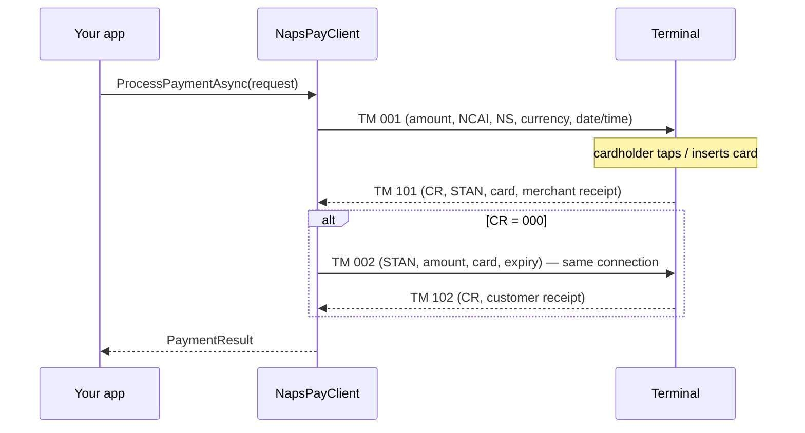

# TKPay NAPS POS SDK — C#

A .NET library that lets a point-of-sale (cash register) application drive a NAPS Pay
payment terminal: take card payments, void them, reprint receipts and run terminal
maintenance commands. It speaks the NAPS Pay ECR TLV protocol (TLV Protocol
Specification v2.0, NapsPay v5.4.4) and handles the protocol details — framing,
two-phase confirmations, receipt parsing, PAN masking — so your code works with
plain C# objects.

This is the **canonical** SDK of the TKpay NAPS family; the
[Node.js](https://github.com/Belkouche/aslan-naps-node),
[Android](https://github.com/Belkouche/tkpay-sdk-pos-android),
[iOS](https://github.com/Belkouche/tkpay-sdk-pos-ios) and
[React Native](https://github.com/Belkouche/tkpay-sdk-pos-rn) SDKs follow it.

Targets **`net10.0`**, **`net9.0`** and **`net48`** (.NET Framework 4.8). Fully `async`.

### Terminals and connections

The SDK has two transports: **TCP** (the terminal's NAPS Pay app listens on port
4444 over Wi-Fi) and **USB serial**.

| Terminal (spec §2) | Connection in the spec | What this SDK supports |
|---|---|---|
| Sunmi P2, Sunmi P3, Sunmi P2 Smart PAD | Wi-Fi TCP port 4444, or USB | **TCP**: `new NapsConfig(host: "…")`. USB to a Sunmi has not been tested with this SDK — use Wi-Fi. |
| Ingenico Self 5000, Ingenico Lane 3600 | USB only | **USB serial**: `NapsConfig.Serial(…)`. Port auto-discovery looks for Ingenico's USB vendor id `0x0B00`. The serial transport was developed against an Ingenico Lane/3000; this SDK has not been run on a Self 5000 or Lane 3600 (the Lane 3600 behaviour below was found with the Node SDK). |

**Lane 3600 over USB:** the terminal holds back its answers until about 30 s after the
port opens, so the first request after opening waits until the port has been open 32 s.
A payment sent earlier would get its approval too late to confirm ("attente validation
caisse", then timeout). Open the connection once when the app starts and keep it open
between transactions, so only the first request waits.

```csharp
// Sunmi over Wi-Fi (TCP 4444). Terminal and register must be on the same network.
var tcp = new NapsConfig(host: "192.168.1.50");

// Ingenico over USB serial: null port name = auto-discover, or pass "COM5" / "/dev/ttyACM0".
// The first request after the port opens waits until it has been open 32 s (see below).
var usb = NapsConfig.Serial();

// Optional settings (defaults shown).
var tuned = new NapsConfig(
    host: "192.168.1.50",
    port: 4444,
    timeout: TimeSpan.FromMinutes(2),              // waiting for a reply (incl. the cardholder)
    confirmationTimeout: TimeSpan.FromSeconds(40)); // waiting for TM 102 / TM 104
```

---

## Install

The SDK is consumed from source (it is not published to NuGet):

```bash
git clone https://github.com/Belkouche/tkpay-sdk-pos-naps-csharp.git
```

Reference the library project from your application:

```xml
<ProjectReference Include="../tkpay-sdk-pos-naps-csharp/src/TKPay.Naps/TKPay.Naps.csproj" />
```

Dependencies are pulled in automatically: `System.IO.Ports`, plus on `net48`
`Microsoft.Bcl.AsyncInterfaces`, `System.Memory` and `System.Threading.Tasks.Extensions`.

---

## Quickstart

This is [`examples/Quickstart/Program.cs`](examples/Quickstart/Program.cs). It runs
as-is against the emulator (see [Testing with the emulator](#testing-with-the-emulator)):

```csharp
using TKPay.Naps;
using TKPay.Naps.Models;

// Emulator on this machine (port 4444, or pass another port).
// For a real terminal: new NapsConfig(host: "192.168.1.50")
var port = args.Length > 0 ? int.Parse(args[0]) : NapsConfig.DefaultPort;
var client = new NapsPayClient(NapsConfig.Localhost(port));

var result = await client.ProcessPaymentAsync(
    new PaymentRequest(amount: 150.00m, registerId: "01", cashierId: "00001"));

if (result.IsApproved())
{
    Console.WriteLine($"Approved  STAN={result.Stan}  card={result.GetFormattedCardNumber()}");
    Console.WriteLine(result.CustomerReceipt?.ToPlainText());
}
else
{
    Console.WriteLine($"Declined [{result.ResponseCode}] {result.Error}");
}
```

The emulator lives in its own repository. Clone it next to this one so the commands below work as written:

```bash
git clone https://github.com/Belkouche/tkpay-naps-emulator.git ../tkpay-naps-emulator
```

```bash
python3 ../tkpay-naps-emulator/naps_emulator.py --port 4444   # terminal 1
dotnet run --project examples/Quickstart                                                   # terminal 2
```

There is no separate "connect" call: every operation opens the connection, runs the
whole exchange and closes it. Create one `NapsPayClient` per terminal and reuse it —
it generates the 6-digit sequence numbers (NS) for you.

---

## How a payment works

A payment is two request/response pairs **on the same connection**:

1. **Payment request (TM 001 → TM 101).** The SDK sends the amount (in centimes,
   tag 002), the register + cashier id (NCAI, tag 003), the sequence (NS, tag 004),
   currency 504 (MAD) and the date/time. The terminal asks for the card, contacts the
   bank and answers TM 101 with the response code (CR, tag 013), the STAN (tag 008),
   the masked card and the merchant receipt.
2. **Confirmation (TM 002 → TM 102).** If TM 101 is approved (CR 000), the SDK
   immediately confirms with TM 002, echoing the STAN, amount, masked card and expiry
   so the terminal can check it is confirming the right transaction. The terminal
   answers TM 102 with the customer receipt. Without this confirmation the terminal
   reverses the payment on its own.



What you get back (`PaymentResult`):

| Case | `IsApproved()` | `ResponseCode` | Receipts |
|---|---|---|---|
| TM 101 and TM 102 both CR 000 | `true` | `000` | `MerchantReceipt` (TM 101), `CustomerReceipt` (TM 102) |
| TM 101 declined (e.g. 116 insufficient funds) | `false` | the decline code | `MerchantReceipt` holds the decline slip if the terminal sent one |
| TM 101 approved but TM 102 refused (e.g. 482, the terminal reversed it) | `false` | the TM 102 code | `MerchantReceipt` only if TM 102 carried one |

Other fields: `Stan` (keep it — you need it to void), `MaskedCardNumber`,
`CardExpiry` (YYMM; `GetFormattedExpiry()` gives MM/YY), `AuthNumber`, `EntryMode`,
`Sequence`, `Ncai`, `Error` (readable text when declined).

Declines are **results, not exceptions**. Exceptions are only for connectivity and
protocol failures (see [Errors and timeouts](#errors-and-timeouts)).

---

## How a void works

Voiding (cancelling) a payment is also two pairs on one connection:

1. **Cancellation request (TM 003 → TM 103).** Identifies the payment by its STAN and
   amount. CR 000 here only means *"transaction found"* — nothing is reversed yet. The
   reply carries the merchant void receipt.
2. **Cancellation confirmation (TM 004 → TM 104).** The SDK sends it right away; this
   is what actually executes the reversal. TM 104 carries the void's own STAN and the
   customer void receipt.

The Ingenico Lane3600 sends no receipt with TM 103: its only void receipt comes with
TM 104, and the SDK returns it as `MerchantReceipt`, with no `CustomerReceipt`.

`CancelAsync` returns a `CancellationResult` whose `Status` is one of:

| `Status` | When | What to do |
|---|---|---|
| `Completed` | TM 104 with CR **000** or **480** | The payment is voided. `Stan` is the void's STAN. |
| `Failed` | TM 103 or TM 104 with any other CR (e.g. 302 not found, 482 already cancelled) | Nothing was reversed. Show `ResponseCode`. |
| `Pending` | No TM 104 within `ConfirmationTimeout`, or TM 104 with CR **995** | **Unknown** — the reversal may or may not have executed. Never treat as voided; verify. |

A pending result keeps `Stan` (the payment being voided) and `MerchantReceipt` (from
TM 103). `ResponseCode` is `"995"`, or `""` when no TM 104 arrived. CR 995 is
"server processing error" in the spec but has been seen with voids that did go
through on a live terminal, which is why it is pending rather than failed.

```csharp
var payment = await client.ProcessPaymentAsync(
    new PaymentRequest(amount: 150.00m, registerId: "01", cashierId: "00001"));

var voidResult = await client.CancelAsync(
    stan: payment.Stan!,
    registerId: "01",
    cashierId: "00001",
    sequence: payment.Sequence ?? "000001",
    amountCentimes: 15000); // required by NapsPay v5.4.4

switch (voidResult.Status)
{
    case CancellationStatus.Completed:
        Console.WriteLine($"Voided. Void STAN {voidResult.Stan}");
        Console.WriteLine(voidResult.CustomerReceipt?.ToPlainText());
        break;

    case CancellationStatus.Failed:
        Console.WriteLine($"Void refused [{voidResult.ResponseCode}]");
        break;

    case CancellationStatus.Pending:
        // Outcome unknown. Look the payment up on the terminal before doing anything else.
        var check = await client.DuplicateReceiptByStanAsync(voidResult.Stan!);
        Console.WriteLine($"Void unconfirmed. Terminal record for STAN {voidResult.Stan}:");
        Console.WriteLine(check.MerchantReceipt?.ToPlainText());
        break;
}
```

To resolve a pending void, an operator can read the reprinted receipt, or the app
can call `CancelAsync` again: if the first void did go through, the terminal refuses
the second with "already cancelled" (482 in the spec; 992 has been seen on a live
v5.4.4 terminal), and if it didn't, the retry performs it.

The `sequence` you pass is sent in NSA (tag 005) in TM 003 and in NS (tag 004) in
TM 004. The amount the terminal returns in TM 103 is echoed in TM 004 — the v5.4.4
terminal refuses TM 004 without it (CR 909). If the terminal answers TM 003 directly
with TM 104, the SDK classifies that TM 104 the same way without sending TM 004.

---

## Other operations

All of these open a connection, send one request and read one reply. `registerId`
and `cashierId` default to `"01"` / `"00001"`.

**Network test (TM 009)** — checks the register → terminal → bank host chain:

```csharp
var net = await client.NetworkTestAsync();
Console.WriteLine(net.Success ? "Network OK" : $"Network test failed [{net.ResponseCode}] {net.Message}");
```

**Duplicate receipt (TM 008)** — reprint the last transaction, or a given one of the
current business day by STAN. Returns a `PaymentResult`; the receipt is in `MerchantReceipt`:

```csharp
var last = await client.DuplicateReceiptAsync();
Console.WriteLine(last.MerchantReceipt?.ToPlainText());

var byStan = await client.DuplicateReceiptByStanAsync("124589");
Console.WriteLine(byStan.IsApproved() ? byStan.MerchantReceipt?.ToPlainText() : $"Not found [{byStan.ResponseCode}]");
```

**Totals (TM 010)** — the terminal's running totals, as a `Receipt`:

```csharp
var totals = await client.TotalsAsync();
Console.WriteLine(totals.Success ? totals.Receipt?.ToPlainText() : $"Totals failed [{totals.ResponseCode}]");
```

**Settlement** — `SettlementAsync` also sends TM 010 (the spec has no separate
settlement message); it returns `Success`, `ResponseCode`, `Date`, `Time`, `Error`
and the terminal's `Receipt`:

```csharp
var settlement = await client.SettlementAsync(registerId: "01", cashierId: "00001");
Console.WriteLine(settlement.Success ? $"Settled {settlement.Date} {settlement.Time}" : settlement.Error);
```

**Referencing (TM 013)** — load a parameter set on the terminal: `"01"` merchant
(default), `"02"` recharge:

```csharp
var referencing = await client.ReferencingAsync(tide: "01");
Console.WriteLine($"Referencing [{referencing.ResponseCode}] set={referencing.ParameterSet}");
Console.WriteLine(referencing.Receipt?.ToPlainText());
```

**Reset PIN pad (TM 012)** — sends the command and ignores the reply. TM 012 is not
in spec v2.0; it is kept for terminals that accept it:

```csharp
await client.ResetPinPadAsync();
```

**Reachability** — `TestConnectionAsync` only checks that the TCP connection (or
serial port) opens; it sends nothing to the terminal:

```csharp
bool reachable = await client.TestConnectionAsync();
Console.WriteLine(reachable ? "Terminal reachable" : "Cannot connect");
```

**Serial port helpers:**

```csharp
string[] ports = NapsPayClient.ListPorts();   // every serial port on the machine
string? ingenico = NapsPayClient.FindPort();  // best Ingenico match, or null
```

---

## Receipts, PAN masking and response codes

### Receipts (DP block)

The receipt is the DP field (tag 010) the terminal sends, in the layout the terminal
defines; the SDK reproduces it exactly: every line, in order, with nothing added, merged or blanked. Each
line is nested TLV — line number (030), style (031: `S` normal, `G` bold), alignment
(032: `C` centre, `D` right, `G` left) and text (033) — lines are separated by `*`
and `?` ends the block. The SDK reads the block by TLV lengths, so a `*` inside the
text (as in the masked PAN `516794******3315`) stays part of the line.

Which copy comes from which message:

| Operation | `MerchantReceipt` ("Copie Commercant") | `CustomerReceipt` ("Copie Client") |
|---|---|---|
| Payment (`PaymentResult`) | TM 101 | TM 102 |
| Void (`CancellationResult`) | TM 103 (kept when the void is pending) | TM 104 |
| Declined payment | the decline slip from TM 101, if sent | — |
| Duplicate (`DuplicateReceiptAsync` / `…ByStanAsync`) | TM 108, as sent | — |

`TotalsResult`, `ReferencingResult` and `SettlementResult` carry the TM 110 / TM 113
block as `Receipt` (their `ReceiptText` is the same block unparsed).

Printing both copies of a payment:

```csharp
var sale = await client.ProcessPaymentAsync(
    new PaymentRequest(amount: 10.00m, registerId: "01", cashierId: "00001"));

if (sale.IsApproved())
{
    Console.WriteLine(sale.MerchantReceipt?.ToPlainText());  // keep for the shop
    Console.WriteLine(sale.CustomerReceipt?.ToPlainText());  // hand to the customer
}
```

A 10.00 MAD payment against the emulator prints this customer copy (the merchant copy
is the same with "Copie Commercant"; void copies end with "ANNULATION" then the copy
line):

```
TKpay
--------------------------------
07/11/2026 00:14:48
TKPAY DEMO
CASABLANCA
--------------------------------
VISA
516794******3315
Terminal: 00000001
Transaction: 599374
Autorisation: 551901
STAN: 599374
--------------------------------
MONTANT: 10.00 MAD
--------------------------------
DEBIT
Copie Client
```

`ToPlainText()` joins the lines' text with newlines. Bold and alignment stay on each
`ReceiptLine` (`LineNumber`, `Text`, `Bold`, `Alignment`) for your printer driver;
`ToFormattedText()` is a quick view with `[B]` and `[C]`/`[R]`/`[L]` prefixes:

```csharp
var copy = await client.ProcessPaymentAsync(
    new PaymentRequest(amount: 10.00m, registerId: "01", cashierId: "00001"));

foreach (var line in copy.CustomerReceipt?.Lines ?? Array.Empty<ReceiptLine>())
{
    var text = line.Alignment switch
    {
        Alignment.Center => line.Text.PadLeft((32 + line.Text.Length) / 2).PadRight(32),
        Alignment.Right  => line.Text.PadLeft(32),
        _                => line.Text
    };
    Console.WriteLine(line.Bold ? $"\u001b[1m{text}\u001b[0m" : text);  // terminal bold; use your printer's bold command
}
```

### PAN masking

Card numbers are masked (first 6 + last 4 digits) the moment the terminal's reply is
parsed, before anything else sees it:

- **Card number field (NCAR, tag 007)** — always returned as first 6 digits, one `*`
  per hidden digit, last 4 digits (`516794******3315`), whatever grouping it arrived in.
- **Receipt text** — any run of 13 or more digits, where consecutive digits are
  adjacent or separated by exactly one space, dash, dot, tab or non-breaking space,
  has every digit masked except the first 6 and last 4 of the run (longer runs too).
  Separators and line length stay as they were: `5167 9400 0012 3315` →
  `5167 94** **** 3315`. Dates and times (`07/11/2026 00:12:10`), amounts (`10.00`,
  `1 250,00`), STAN, terminal and authorisation numbers, and any shorter digit run are
  left untouched.

The full number is never exposed in any result, receipt, raw field or error message,
and never logged; the SDK itself writes no logs. The same helpers are public:

```csharp
using TKPay.Naps.Protocol;

Console.WriteLine(NapsTlv.MaskPan("5167940123453315"));              // 516794******3315
Console.WriteLine(NapsTlv.MaskPansInText("Card 5167940123453315"));  // Card 516794******3315
```

### Response codes

`NapsTlv.DescribeResponse(code)` returns the text for any response code (CR, tag
013). The full table — spec §6 plus the NapsPay ISO codes — is
`TlvProtocol.ResponseCodes` in
[`src/TKPay.Naps/Protocol/TlvProtocol.cs`](src/TKPay.Naps/Protocol/TlvProtocol.cs).

```csharp
using TKPay.Naps.Protocol;

Console.WriteLine(NapsTlv.DescribeResponse("116"));  // Insufficient funds
Console.WriteLine(NapsTlv.IsApproved("000"));         // True (000, 001, 003, 007 are approvals in §6)
```

Note that `ProcessPaymentAsync` and `PaymentResult.IsApproved()` only accept **000**,
which is the code the terminal sends for an approved payment.

### Lower-level access

`NapsTlv.BuildField` / `NapsTlv.Parse` expose the ASCII TLV wire format
(`TAG(3) LENGTH(3) VALUE`), and `BinaryTlvProtocol` implements the binary
`tag(1) + length(2, big-endian) + value` framing used by some Sunmi deployments.
You don't need either for normal use.

---

## Errors and timeouts

Operations throw `NapsException` only for transport and protocol problems.
`ex.Code` tells you which:

| `NapsErrorCode` | Thrown when |
|---|---|
| `ConnectionFailed` | The TCP connection could not be opened within `Timeout`, the serial port could not be found or opened, or a write failed. |
| `Timeout` | No reply within `Timeout` (TM 001 and single-request operations) or `ConfirmationTimeout` (TM 002). |
| `InvalidResponse` | The connection closed before a reply, the reply was empty, or a payment reply lacked the response code or STAN. |

The other enum values (`PaymentDeclined`, `TerminalDown`, `TransactionNotFound`,
`AlreadyCancelled`, `UnknownError`) are not thrown by `NapsPayClient` today:
declines come back as results.

```csharp
try
{
    var r = await client.ProcessPaymentAsync(
        new PaymentRequest(amount: 150.00m, registerId: "01", cashierId: "00001"));
    Console.WriteLine(r.IsApproved() ? "Approved" : $"Declined: {r.Error}");
}
catch (NapsException ex) when (ex.Code == NapsErrorCode.ConnectionFailed)
{
    Console.WriteLine("Cannot reach the terminal: check the IP, the network and that NapsPay is running.");
}
catch (NapsException ex) when (ex.Code == NapsErrorCode.Timeout)
{
    Console.WriteLine("The terminal did not answer in time.");
}
catch (NapsException ex)
{
    Console.WriteLine($"Protocol error [{ex.Code}]: {ex.Message}");
}
```

Timeouts and framing, as implemented:

- `Timeout` (default **2 minutes**) covers the TCP connect and every first reply,
  including the time the cardholder takes at the terminal.
- `ConfirmationTimeout` (default **40 seconds**) covers TM 102 and TM 104. For a
  void, running out of time gives a `Pending` result instead of an exception.
- A reply ends at the terminator — `!` (protocol v2, TCP default) or `?` (v1, USB
  serial default); both are accepted either way — or after **1 second** of silence,
  because the live terminal sends TM 103/104 without a terminator.
- Requests are sent without a terminator. Force the version with
  `new NapsConfig(host: "…", protocolVersion: ProtocolVersion.V1)` if needed.

---

## Testing with the emulator

`tkpay-naps-emulator` is a Python (stdlib only) terminal emulator that speaks the
same protocol, so you can develop without hardware:

```bash
python3 ../tkpay-naps-emulator/naps_emulator.py --port 4444
```

Useful options (`--help` lists them all):

| Option | Behaviour |
|---|---|
| `--mode approve` | Approve everything (default) |
| `--mode decline` | TM 101 with CR 100 (do not honour) |
| `--mode error --code 116` | TM 101 with the given code (number or name, e.g. `insufficient_funds`) |
| `--mode confirm_error --code 482` | TM 101 approved, TM 102 refused with the code |
| `--mode timeout` | Never answers TM 001 (tests `Timeout`) |
| `--mode no_confirm` | Never answers TM 002 (tests `ConfirmationTimeout`) |
| `--mode void_refuse --code 302` | TM 103 refuses the void |
| `--mode void_480` | TM 104 with CR 480 (completed) |
| `--mode void_995` | TM 104 with CR 995 (pending) |
| `--mode void_no_confirm` | No reply to TM 004 (pending) |
| `--mode interactive` | Approve or decline each payment from the keyboard |
| `--strict-confirm` | Refuse TM 002 (CR 307) if its echoed amount/card don't match TM 101 |
| `--protocol v1` | Terminate replies with `?` instead of `!` |
| `--debug` | Print every TLV field received |

### This repo's tests

```bash
dotnet build      # library (net10.0, net9.0, net48), tests and the Quickstart example
dotnet test       # unit tests; the emulator integration tests are skipped
```

The void integration tests run against a live emulator, one mode at a time:

```bash
python3 ../tkpay-naps-emulator/naps_emulator.py --port 4451 --mode void_995
NAPS_EMULATOR_MODE=void_995 NAPS_EMULATOR_PORT=4451 dotnet test --filter Category=Integration
```

Modes covered: `approve`, `void_480`, `void_995`, `void_no_confirm` and
`void_refuse` (start it with `--code 302`). In `approve` mode the receipt tests also
run: a 10.00 MAD payment and its void must produce the golden merchant and customer
copies shown in [Receipts](#receipts-dp-block).

---

## Troubleshooting

| Symptom | Likely cause and fix |
|---|---|
| `NapsException` `ConnectionFailed` on TCP | Wrong IP, register and terminal on different networks, or NapsPay not running / not idle on the terminal. Check that port 4444 is reachable (`nc -z <ip> 4444`). |
| `ConnectionFailed` on USB | No serial port found or it is in use. Check the cable and drivers, list ports with `NapsPayClient.ListPorts()`, or pass the port name to `NapsConfig.Serial("COM5")`. |
| `Timeout` on a payment | Nobody presented a card within `Timeout`, or the terminal is busy on another screen. |
| `Timeout` after the payment was approved | TM 102 didn't arrive within `ConfirmationTimeout`. The terminal reverses an unconfirmed payment by itself; treat the sale as not paid. |
| CR **909** | System failure — terminal or bank host unavailable. On a void, also returned when TM 004 lacks the amount: the SDK echoes TM 103's amount, falling back to `amountCentimes` — always pass it. |
| CR **302** | Record not found — wrong STAN, or a transaction from another business day. |
| CR **482** (or **992** on the live terminal) | Already cancelled. On a retry after a pending void, this means the first void went through. |
| Void `Pending` | See [How a void works](#how-a-void-works): reprint by STAN with `DuplicateReceiptByStanAsync`, or retry the void and look for "already cancelled". |
| Payment declined with a code you don't recognise | `NapsTlv.DescribeResponse(code)`, or the table in `TlvProtocol.cs`. |

---

## Changelog

See [CHANGELOG.md](CHANGELOG.md). 1.5.0 brings the SDK in line with NapsPay v5.4.4:
two-phase void with pending results, refused payment confirmations, duplicate receipt
by STAN and the full response-code table.
